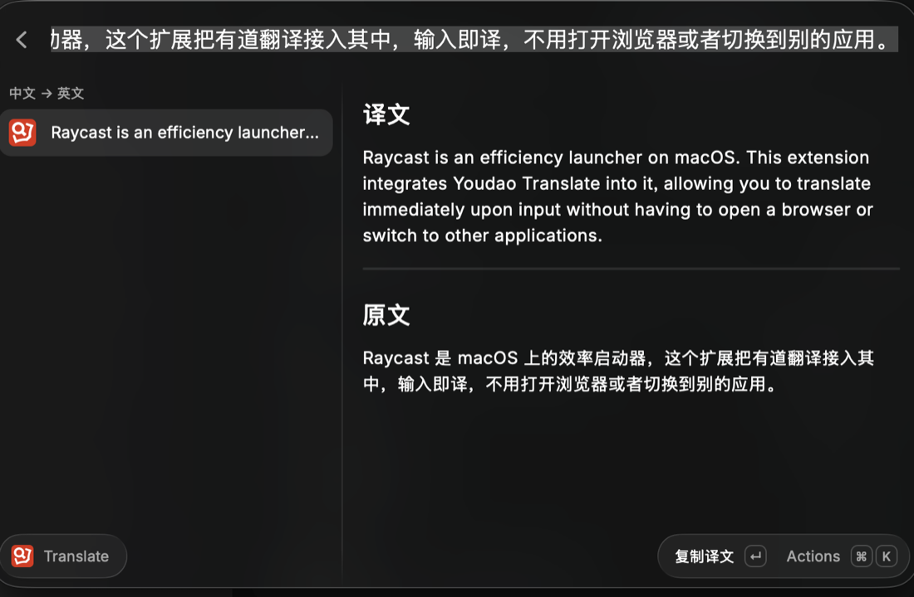
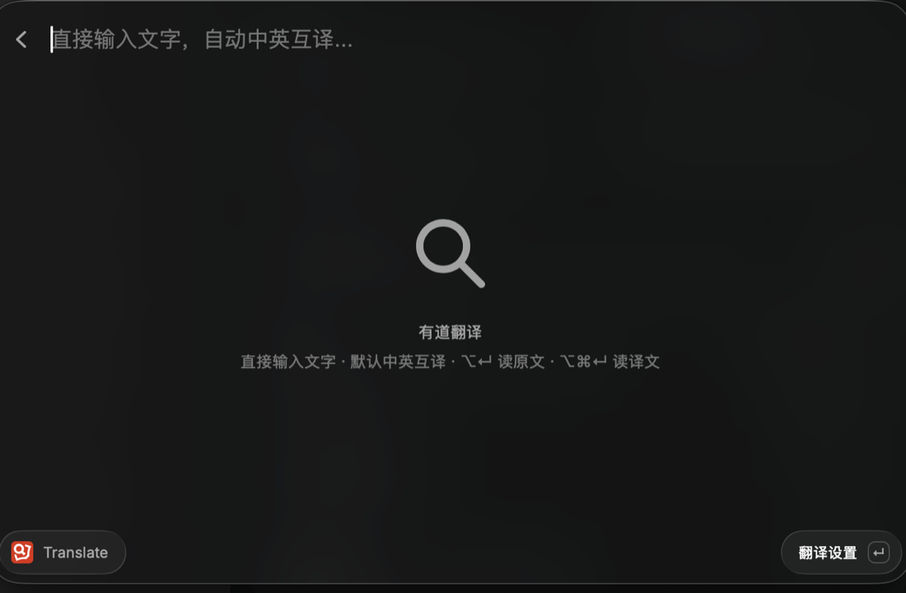
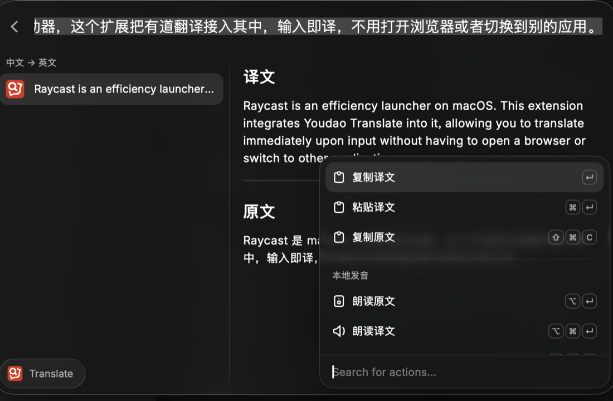

<div align="center">
  
  <h1>Youdao Translator</h1>
  <p><b>有道翻译的 Raycast 扩展</b> —— 输入即译，中英互译、段落翻译与 macOS 本地朗读</p>
  <p>
    
    
    
  </p>
</div>

在 Raycast 里敲 `yd` 回车，直接开始打字，停顿半秒自动出译文。不用打开浏览器，不用切到别的应用，也不用点提交。



## 特性

- **输入即译** —— 没有 Content / From / To 表单。输入停顿 0.5 秒自动查询，改一个字就重新翻译。
- **自动中英互译** —— 默认按内容判断中英方向。需要其他语言时在设置里切到「自定义语言」，支持 11 种语言。
- **段落翻译** —— 单次最多 5000 字符，保留段落换行。长文本自动展开左右分栏，同屏对照原文与译文。
- **本地朗读** —— 用 macOS 内置语音朗读原文或译文，不消耗有道语音合成额度。
- **启动器参数** —— `yd` → 空格 → 文字 → 回车，一步把文字带进扩展。
- **防抖与取消** —— 输入变化时取消旧请求、忽略迟到响应；会话内缓存最近 20 条结果，重复查询不再走网络。
- **看得懂的报错** —— 有道的业务错误码会翻成中文提示，比如余额不足、签名不匹配、应用未绑定服务。

## 安装

需要 macOS、[Raycast](https://www.raycast.com/) 和 Node.js 18+。扩展没有上架 Raycast Store，从源码安装：

```sh
git clone https://github.com/0xAiKang/youdao-translator.git
cd youdao-translator
npm install
npm run dev
```

`npm run dev` 会把扩展注册进本地 Raycast 并监听源文件。在 Raycast 里看到 **Translate** 命令出现之后，就可以关掉终端里的 dev 进程了 —— 扩展已经装好，日常使用不依赖终端常驻。

装好后建议给命令设一个别名：在 Raycast 里选中 **Translate** 命令，按 `⌘K` → **Add Alias**，填 `yd`。下文都以 `yd` 为例。

## 申请有道 API 凭据

扩展调用的是有道智云的文本翻译接口，需要自己申请一对 AppKey / 密钥（有免费额度）：

1. 注册 [有道智云](https://ai.youdao.com/) 账号
2. 创建一个 [自然语言翻译服务](https://ai.youdao.com/fanyi-services.s)
3. 创建一个 [有道云应用](https://ai.youdao.com/appmgr.s)，并**绑定**第 2 步创建的服务
4. 回到 [应用管理](https://ai.youdao.com/appmgr.s) → 应用详情，把「应用ID」填入 **APP Key**，「应用密钥」填入 **APP Secret**

填写位置：Raycast Settings → Extensions → Youdao Translate，或者在扩展里按 `⌘K` → **翻译设置**。

> 第 3 步的「绑定服务」最容易漏。漏了会报 `有道 110：该应用尚未绑定文本翻译服务`。
> 如果报 `有道 202：签名校验失败`，检查 APP Key 与 APP Secret 是不是来自同一个应用。

## 使用



两种用法：

- **`yd` 回车**，进入扩展后直接打字，停顿约 0.5 秒自动翻译；继续改字会重新翻译。
- **`yd` → 空格 → 输入文字 → 回车**，把文字作为启动参数直接带进来。

译文较长或含换行时会自动切成左右分栏，右侧同屏显示完整译文与原文；也可以随时按 `⌘D` 单独打开详情页。如果有道对该词返回了词典数据，列表里会额外出现音标与「词典释义」分区。

默认中译英、英译中。要翻其他语言，到 Raycast Settings → Extensions → Youdao Translate 把「翻译方向」改成「自定义语言」，再设置源语言与目标语言。

> Raycast 的第三方扩展需要先回车进入命令，结果页才会随输入自动更新。在主启动器里还没进入命令时不会发起查询。

## 快捷键



| 按键 | 操作 |
| --- | --- |
| `↵` | 复制当前译文／释义 |
| `⌘` `↵` | 粘贴到当前应用 |
| `⇧` `⌘` `C` | 复制原文 |
| `⌥` `↵` | 朗读原文 |
| `⌥` `⌘` `↵` | 朗读当前译文／释义 |
| `⌥` `⌘` `.` | 停止朗读 |
| `⌘` `D` | 查看完整原文与译文 |
| `⌘` `K` | 打开 Action Panel（含「翻译设置」） |

朗读用的是 macOS 本地语音，不需要开通有道语音合成服务。英文优先 Samantha、简体中文优先 Tingting，另外还为繁中、日、韩、法、德、西、意、俄、葡配了首选音色；首选音色没装时按语种回退到已安装的声音。关闭命令或再次朗读会停掉上一次播放。

## 设置项

| 设置 | 说明 |
| --- | --- |
| **APP Key** | 有道云应用的应用ID，必填 |
| **APP Secret** | 有道云应用的应用密钥，必填，以密码形式存储 |
| **翻译方向** | `自动中英互译`（默认）或 `自定义语言` |
| **自定义：源语言** | 仅自定义模式生效。自动识别／中文／英文／繁体中文／日／韩／法／德／西／俄／葡／意 |
| **自定义：目标语言** | 仅自定义模式生效，默认中文 |
| **本地朗读速度** | 慢速 140、正常 170（默认）、快速 210 词/分 |
| **Handle Annotation** | 翻译前去掉输入里的注释符号（`//`、`/*`、`*/` 等），默认关闭 |

## 隐私与计费

- 走有道官方 HTTPS 接口，POST 提交，v3（SHA-256）签名。
- 凭据只存在 Raycast 的扩展偏好设置里；仓库、文档和测试都不含真实凭据，测试全用假凭据。
- 只有你输入的、或通过启动参数传入的文字会发给有道。扩展不读剪贴板，也不读当前应用的选中文本。
- 最近 20 条译文只留在本次命令会话的内存里，不落盘。不保存查询日志，也不保存语音文件。
- 本地朗读调用 `/usr/bin/say`，文本经 stdin 传入、不经过 shell，不上传任何内容。
- 有道按字符计费。0.5 秒防抖会取消来不及的请求，但**已经发出的请求仍可能被计费**，额度请以有道控制台为准。

## 开发

```sh
npm install              # 安装依赖
npm run dev              # 注册并监听本地扩展
npm run build            # 构建到 Raycast 本地扩展目录
npm test                 # 离线单元测试
npm run test:speech      # 会真的出声：中英文朗读 + 中止播放
npm run lint             # ray lint
npm exec -- tsc --noEmit # 类型检查
```

`npm test` 覆盖语言方向判断、v3 签名与请求体、有道错误码映射、文本边界（5000 字符）、会话缓存淘汰和音色选择，全部离线、不调用有道接口。

`ray lint` 会校验 `package.json` 里的 `author` 是不是 Raycast 平台上已注册的用户名，没注册的话这一项会报 `Invalid author`。它只影响 lint 和提交 Raycast Store，`npm run dev` 与 `npm run build` 都不受影响。

```
src/core.ts               纯逻辑：签名、请求构造、响应解析、错误码、语言判断、LRU 缓存
src/speech.ts             macOS say 封装：音色选择、播放与中止
src/youdao_translate.tsx  Raycast UI：List 视图、防抖、Action Panel
tests/                    node:test 单元测试
docs/                     README 配图
```

## 来源与致谢

上游是 [raycast/extensions](https://github.com/raycast/extensions/tree/709e3df645ea4c5748584a5019e8b647510e70f9/extensions/youdao-translate) 里的 **Youdao Translate** 扩展，作者 [tiancheng92](https://github.com/tiancheng92)，MIT 许可。感谢原作者把有道翻译接进了 Raycast。

本仓库在此基础上做了这些改动：

- 表单界面（Content / From / To 三个字段 + 提交）换成输入即译的 List 视图
- 翻译请求从 MD5 / GET 升级到 v3 SHA-256 / HTTPS POST
- 语言方向做成可持久化的偏好设置，默认智能判断中英方向
- 加入防抖、请求取消、迟到响应丢弃与会话内缓存
- 加入 macOS 本地朗读（原文／译文／停止）
- 有道错误码转成中文提示，保留段落换行，限制单次 5000 字符
- 补上离线单元测试

扩展的 `author` 已改为本仓库作者，因此 Raycast 会把它当作一个新扩展。如果你之前装过上游版本，凭据需要在新扩展的设置里重新填一次。

## License

[MIT](LICENSE)，保留 Raycast 与上游作者的版权声明。
